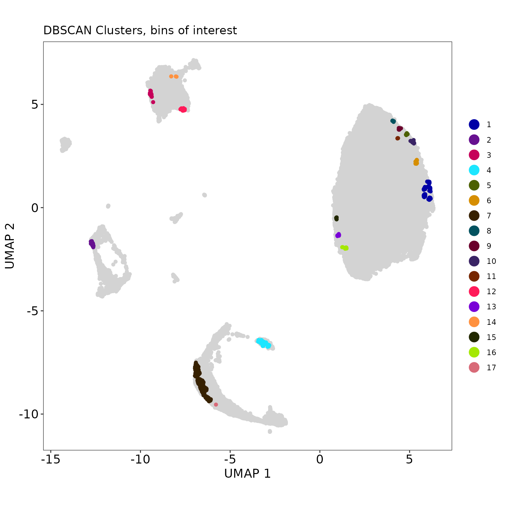
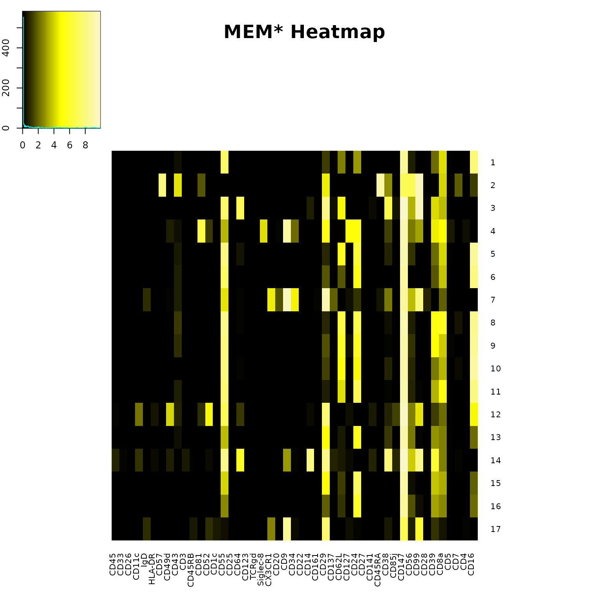
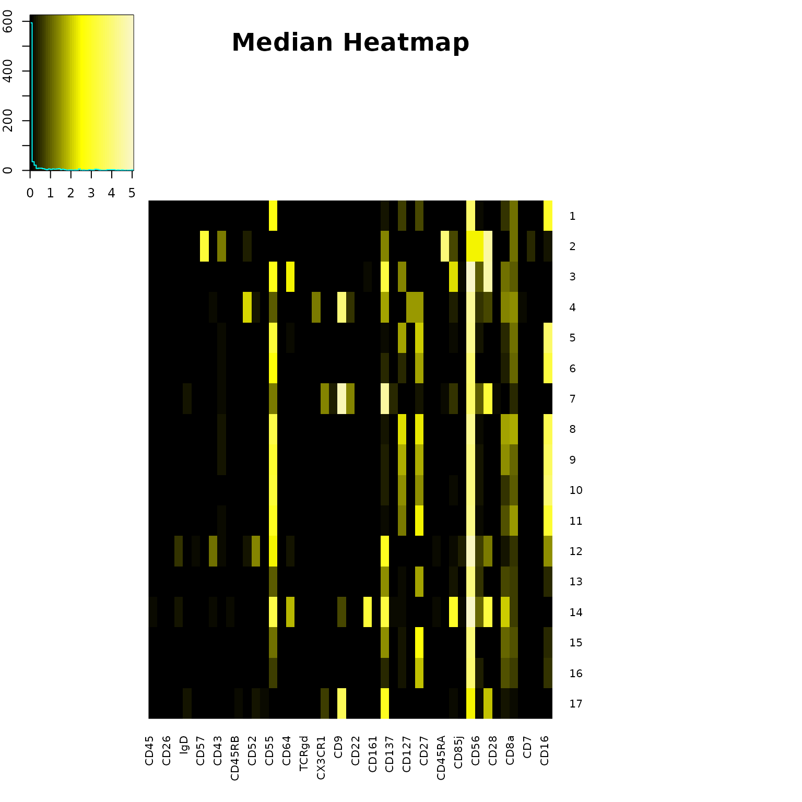
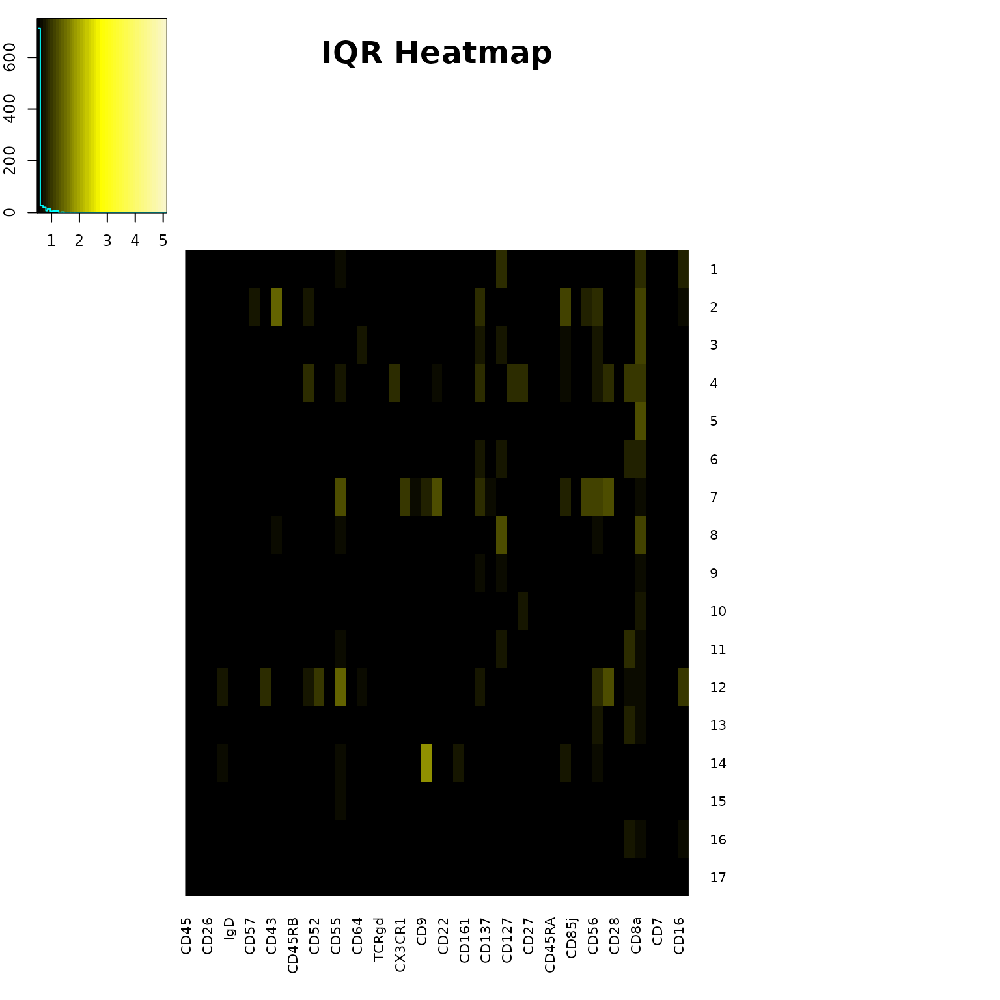

# T-REX Analysis on COVID Data

## Tracking Responders Expanding

``` r

knitr::opts_chunk$set(
  fig.width = 8,
  fig.height = 8,
  dpi = 96
)
```

``` r

Folder <- system.file("extdata", package="TRexR")
StorageLocation <- file.path(Folder, "brodin_covid")
fcs_files <- list.files(StorageLocation, pattern=".fcs", full.names=TRUE)

OutputLocation <- file.path(tempdir(), "TRexR-vignette")
dir.create(OutputLocation, showWarnings = FALSE, recursive = TRUE)
```

``` r

# read in files 
first.dataset <- as.data.frame(lapply(lapply(
  fcs_files[[1]], read.FCS, truncate_max_range=FALSE), exprs), check.names=FALSE)
second.dataset <- as.data.frame(lapply(lapply(
  fcs_files[[2]], read.FCS, truncate_max_range=FALSE), exprs), check.names=FALSE)

# save original column names for final export to FCS files 
orig.names <- colnames(first.dataset)

# rename columns with marker names 
colnames(first.dataset)[1:(length(first.dataset))] <- as.character(
  read.FCS(fcs_files[[1]], truncate_max_range=FALSE)@parameters@data[["desc"]])
#colnames(first.dataset)[1:2] <- c("Time", "Cell_length")
colnames(second.dataset)[1:(length(second.dataset))] <- as.character(
  read.FCS(fcs_files[[2]], truncate_max_range=FALSE)@parameters@data[["desc"]])

# create meaningful names for data sets to be analyzed 
first.dataset$file_ID = "Timepoint 1"
second.dataset$file_ID = "Timepoint 2"
```

``` r

# find number of data points in smaller sample 
smaller_sample = nrow(first.dataset) 
if (nrow(second.dataset) < smaller_sample) { 
  smaller_sample <- nrow(second.dataset) 
}

# set a seed to get a reproducible sample 
set.seed(1)

# get an equal number of data points from both data sets
sampled.data = as.data.frame(rbind(
  first.dataset[sample(nrow(first.dataset), smaller_sample), ], 
  second.dataset[sample(nrow(second.dataset), smaller_sample), ]
))
```

``` r

# choose markers to make low dimensional embedding 
chosen.data = sampled.data[, c(3,9:14,19:31,33:54,57:61)]

# scale data 
transformed.data = asinh(chosen.data/5) 
```

``` r

dataset.names = unique(sampled.data$file_ID)
#output.folder = paste0(getwd(), "/data_files/brodin covid/T-REX output, ", dataset.names[1], " vs ", dataset.names[2])
#dir.create(output.folder)
```

``` r

# create UMAP (low dimensional embedding)
myumap <- umap(transformed.data, ret_model = TRUE, verbose = TRUE)
```

    ## 20:36:40 UMAP embedding parameters a = 1.896 b = 0.8006

    ## 20:36:40 Converting dataframe to numerical matrix

    ## 20:36:40 Read 81398 rows and found 47 numeric columns

    ## 20:36:40 Using Annoy for neighbor search, n_neighbors = 15

    ## 20:36:40 Building Annoy index with metric = euclidean, n_trees = 50

    ## 0%   10   20   30   40   50   60   70   80   90   100%

    ## [----|----|----|----|----|----|----|----|----|----|

    ## **************************************************|
    ## 20:36:45 Writing NN index file to temp file /tmp/RtmpHGy13x/file5501a3ffece
    ## 20:36:45 Searching Annoy index using 2 threads, search_k = 1500
    ## 20:36:53 Annoy recall = 100%
    ## 20:36:54 Commencing smooth kNN distance calibration using 2 threads with target n_neighbors = 15
    ## 20:36:55 Found 2 connected components, falling back to 'spca' initialization with init_sdev = 1
    ## 20:36:55 Using 'irlba' for PCA
    ## 20:36:55 PCA: 2 components explained 48.88% variance
    ## 20:36:55 Scaling init to sdev = 1
    ## 20:36:56 Commencing optimization for 200 epochs, with 1757994 positive edges
    ## 20:36:56 Using rng type: pcg
    ## 20:37:21 Optimization finished

``` r

# uncomment the line below to save the UMAP 
# save_uwot(myumap, paste0(getwd(), "/", strftime(Sys.time(),"%Y-%m-%d_%H_%M"),"_umap_results"))

umap.data = as.data.frame(myumap$embedding)
colnames(umap.data) <- c("UMAP1", "UMAP2")
```

``` r

my.binned <- TREX(
  embedding.data = cbind(umap.data, file_ID = sampled.data$file_ID),
)

TREX_plot(
  binned.data = my.binned,
  embed.type = "UMAP",
  caption = "Data from Brodin lab in Rodriguez et al., Cell Rep Med. 2020",
  export = TRUE,
  outpath = OutputLocation
)
```


``` r

# The plot title will be incorrectly placed on the image below, but correctly placed on the exported png. The location is based on aspect ratio of the image, and can be adjusted with a title.height parameter if needed. 
```

``` r

TREX_results(my.binned, export = TRUE, outpath = OutputLocation)
```

    ##   total_cells [0,5] (5,15] (15,85) [85,95) [95,100] degree_of_change
    ## 1       81398   288   4302   72141    3732      935         1.502494
    ##   direction_of_change
    ## 1            0.529027

``` r

my.clusters = TREX_cluster(
  binned.data = my.binned, 
  db.eps = 0.3, 
  marker.data = chosen.data
)

TREX_cluster_plot(
  cluster.data = my.clusters,
  binned.data = my.binned,
  embed.type = "UMAP", 
  export = TRUE,
  outpath = OutputLocation
)
```



``` r

TREX_cluster_results(my.clusters, export = TRUE, outpath = OutputLocation)
```

    ##    cluster median.change mean.change
    ## 1        1      5.000000    4.209622
    ## 2        2      3.333333    3.000000
    ## 3        3      3.333333    3.536585
    ## 4        4     95.000000   95.801587
    ## 5        5      5.000000    5.000000
    ## 6        6      5.000000    4.920635
    ## 7        7     96.666667   96.281233
    ## 8        8      5.000000    5.000000
    ## 9        9      5.000000    4.880952
    ## 10      10      3.333333    2.738095
    ## 11      11      5.000000    5.000000
    ## 12      12     96.666667   96.151515
    ## 13      13     95.000000   95.238095
    ## 14      14     95.000000   95.000000
    ## 15      15     95.000000   95.208333
    ## 16      16     95.000000   95.312500
    ## 17      17     95.000000   95.000000

``` r

# run MEM on DBSCAN clusters from 5th and 95th percentiles
MEM.input = my.clusters[, c(6:ncol(my.clusters))]
MEM.input <- MEM.input[order(MEM.input$cluster), ]
MEM.output = MEM(
  MEM.input, 
  transform = TRUE, 
  cofactor = 5,
  choose.markers = FALSE, 
  markers = "all", 
  choose.ref = FALSE, 
  zero.ref = TRUE, 
  rename.markers = FALSE,
  new.marker.names = "none", 
  file.is.clust = FALSE, 
  add.fileID = FALSE, 
  IQR.thresh = NULL,
  scale.matrix = "arcsinh",
  scale.factor = 1
)
build_heatmaps(
  MEM.output, 
  cluster.MEM = "none", 
  cluster.medians = "none",
  display.thresh = 1, 
  output.files = FALSE, 
  labels = FALSE
)
```



    ##  [1] "MEM label for cluster 1 : ▲ CD147+9 CD16+8 CD55+7 CD8a+4 CD24+3 CD62L+2 CD39+2 CD29+1 CD56+1 ▼ None"                                                                           
    ##  [2] "MEM label for cluster 2 : ▲ CD45RA+9 CD99+9 CD57+8 CD147+7 CD56+7 CD29+5 CD43+4 CD8a+4 CD38+3 CD81+2 CD7+2 CD16+1 ▼ None"                                                      
    ##  [3] "MEM label for cluster 3 : ▲ CD147+10 CD99+10 CD29+8 CD55+7 CD64+7 CD38+7 CD62L+5 CD39+4 CD8a+4 CD56+3 CD14+1 ▼ None"                                                           
    ##  [4] "MEM label for cluster 4 : ▲ CD9+9 CD147+9 CD81+6 CD29+5 CD127+5 CD24+5 CD39+5 CD8a+5 CD55+4 Siglec-8+4 CD99+3 CD34+2 CD56+2 CD49d+1 CD52+1 CD38+1 CD5+1 ▼ None"                
    ##  [5] "MEM label for cluster 5 : ▲ CD147+9 CD16+9 CD55+8 CD24+6 CD62L+5 CD8a+4 CD39+2 CD43+1 CD29+1 CD38+1 CD56+1 ▼ None"                                                             
    ##  [6] "MEM label for cluster 6 : ▲ CD147+9 CD16+8 CD55+7 CD24+5 CD8a+4 CD29+2 CD62L+2 CD39+2 CD43+1 ▼ None"                                                                           
    ##  [7] "MEM label for cluster 7 : ▲ CD9+10 CD29+9 CD147+9 CD99+8 CX3CR1+5 CD34+5 CD55+4 CD56+4 CD20+2 CD137+2 CD38+2 CD8a+2 IgD+1 CD43+1 CD24+1 CD28+1 ▼ None"                         
    ##  [8] "MEM label for cluster 8 : ▲ CD147+9 CD55+8 CD16+8 CD62L+7 CD24+7 CD8a+6 CD39+5 CD43+1 CD29+1 CD56+1 ▼ None"                                                                    
    ##  [9] "MEM label for cluster 9 : ▲ CD147+9 CD16+9 CD55+8 CD62L+6 CD24+6 CD39+5 CD8a+4 CD29+2 CD43+1 CD56+1 ▼ None"                                                                    
    ## [10] "MEM label for cluster 10 : ▲ CD147+9 CD16+9 CD55+8 CD62L+5 CD24+5 CD8a+3 CD39+2 CD29+1 CD38+1 CD56+1 ▼ None"                                                                   
    ## [11] "MEM label for cluster 11 : ▲ CD147+9 CD55+8 CD16+8 CD24+7 CD8a+5 CD62L+4 CD39+3 CD43+1 CD29+1 CD56+1 ▼ None"                                                                   
    ## [12] "MEM label for cluster 12 : ▲ CD147+10 CD29+8 CD55+7 CD52+5 CD16+5 CD49d+4 CD99+4 CD11c+2 CD56+2 CD8a+2 CD43+1 CD81+1 CD64+1 CD141+1 CD38+1 CD85j+1 CD39+1 ▼ None"              
    ## [13] "MEM label for cluster 13 : ▲ CD147+9 CD29+5 CD24+5 CD55+4 CD39+3 CD8a+3 CD56+2 CD16+2 CD62L+1 CD38+1 ▼ None"                                                                   
    ## [14] "MEM label for cluster 14 : ▲ CD147+10 CD55+8 CD14+8 CD29+8 CD38+8 CD99+8 CD64+6 CD39+6 CD56+4 CD9+3 CD8a+2 CD45+1 CD11c+1 CD49d+1 CD3+1 CD137+1 CD62L+1 CD141+1 CD85j+1 ▼ None"
    ## [15] "MEM label for cluster 15 : ▲ CD147+9 CD24+7 CD29+5 CD55+4 CD39+4 CD8a+3 CD16+2 CD62L+1 ▼ None"                                                                                 
    ## [16] "MEM label for cluster 16 : ▲ CD147+9 CD24+6 CD55+3 CD39+3 CD8a+3 CD29+2 CD56+2 CD16+2 CD62L+1 ▼ None"                                                                          
    ## [17] "MEM label for cluster 17 : ▲ CD9+9 CD29+8 CD147+7 CD99+6 CX3CR1+3 IgD+1 CD45RB+1 CD52+1 CD1c+1 CD38+1 CD56+1 CD39+1 ▼ None"

``` r

TREX_counts(my.clusters, export = TRUE, outpath = OutputLocation)
```

    ##    cluster total_cells [0,5] [95,100]
    ## 1        1          97    97        0
    ## 2        2          80    80        0
    ## 3        3          41    41        0
    ## 4        4         210     0      210
    ## 5        5          11    11        0
    ## 6        6          21    21        0
    ## 7        7         627     0      627
    ## 8        8           5     5        0
    ## 9        9          14    14        0
    ## 10      10          14    14        0
    ## 11      11           5     5        0
    ## 12      12          55     0       55
    ## 13      13          14     0       14
    ## 14      14           4     0        4
    ## 15      15           8     0        8
    ## 16      16          16     0       16
    ## 17      17           1     0        1

``` r

# create heatmaps of every marker across UMAP axes 
umap.bychannel <- as_tibble(umap.data) %>%
  bind_cols(transformed.data)  %>%
  gather(channel, intensity, -UMAP1, -UMAP2) %>%
  mutate(across(channel, factor)) %>%
  group_split(channel) %>%
  map(
    ~ggplot(., aes(x = UMAP1, y = UMAP2, col = intensity)) +
      geom_point(shape = ".", size = 8) +
      scale_color_gradientn(
        colours = colorRampPalette(rev(brewer.pal(n = 11, name = "Spectral")))(5)) +
      facet_grid(~ channel, labeller = function(x) label_value(x, multi_line = FALSE)) +
      coord_fixed() +
      theme_bw() +
      theme(
        strip.text.x = element_text(size = 20),
        legend.title = element_blank(),
        panel.grid = element_blank(),
        axis.title = element_blank(),
        axis.text = element_blank(),
        axis.ticks = element_blank()
      )
    ) %>%
  plot_grid(plotlist = ., align = 'hv', ncol = 8)

theFileName <- paste0(strftime(Sys.time(),"%Y-%m-%d_%H-%M"), "_marker_heat.png")
StashHere <- file.path(OutputLocation, theFileName)

png(
  StashHere,
  height = 2000,
  width = 4000
)
print(umap.bychannel)
dev.off()
```

    ## agg_png 
    ##       2

``` r

# export new FCS files with sampled data, percent change, and umap axes
to.export = cbind(sampled.data, umap.data, percent.change = my.binned$percent.change)

# add column for cluster number 
to.export$cluster <- c(0)
bins.of.interest = unique(my.clusters$cuts)
temp.cuts = wafflecut(to.export$percent.change, levels(my.binned$cuts))
to.export[temp.cuts %in% bins.of.interest, ]$cluster <- my.clusters$cluster

desc = colnames(to.export)
desc <- desc[! desc %in% c("file_ID")]
colnames(to.export)[1:ncol(sampled.data) - 1] <- orig.names
sep.files = split(to.export, to.export$`file_ID`)
for (i in 1:length(sep.files)) {
  reduce.data = subset(sep.files[[i]], select = -c(`file_ID`))
  mat.input <- as.matrix(reduce.data)
  metadata <- data.frame(name = dimnames(mat.input)[[2]], desc = desc)
  metadata$range <- apply(apply(mat.input, 2, range), 2, diff)
  metadata$minRange <- apply(mat.input, 2, min)
  metadata$maxRange <- apply(mat.input, 2, max)
  input.flowframe <- new("flowFrame", exprs = mat.input, parameters = AnnotatedDataFrame(metadata))
  newname  = str_remove(basename(fcs_files[i]), ".fcs")
  new.filename = file.path(OutputLocation, paste0(strftime(Sys.time(), "%Y-%m-%d_%H-%M"), "_", newname, "_T-REX.fcs"))
  write.FCS(input.flowframe, filename = new.filename)
  print(paste("FCS file ",i," done", sep = ""))
}
```

    ## [1] "FCS file 1 done"
    ## [1] "FCS file 2 done"

``` r

# MEM Clean Up, still making an output files folder, remove it. 
if (dir.exists("output files")){unlink("output files", recursive=TRUE)}
```

``` r

sessionInfo()
```

    ## R version 4.6.2 (2026-10-29)
    ## Platform: x86_64-pc-linux-gnu
    ## Running under: Ubuntu 24.04.5 LTS
    ## 
    ## Matrix products: default
    ## BLAS:   /usr/lib/x86_64-linux-gnu/openblas-pthread/libblas.so.3 
    ## LAPACK: /usr/lib/x86_64-linux-gnu/openblas-pthread/libopenblasp-r0.3.26.so;  LAPACK version 3.12.0
    ## 
    ## locale:
    ##  [1] LC_CTYPE=C.UTF-8       LC_NUMERIC=C           LC_TIME=C.UTF-8       
    ##  [4] LC_COLLATE=C.UTF-8     LC_MONETARY=C.UTF-8    LC_MESSAGES=C.UTF-8   
    ##  [7] LC_PAPER=C.UTF-8       LC_NAME=C              LC_ADDRESS=C          
    ## [10] LC_TELEPHONE=C         LC_MEASUREMENT=C.UTF-8 LC_IDENTIFICATION=C   
    ## 
    ## time zone: UTC
    ## tzcode source: system (glibc)
    ## 
    ## attached base packages:
    ## [1] stats     graphics  grDevices utils     datasets  methods   base     
    ## 
    ## other attached packages:
    ##  [1] TRexR_0.99.1        fancycut_0.1.4      cowplot_1.2.0      
    ##  [4] purrr_1.2.2         stringr_1.6.0       dplyr_1.2.1        
    ##  [7] RColorBrewer_1.1-3  Biobase_2.72.0      BiocGenerics_0.58.1
    ## [10] generics_0.1.4      tidyr_1.3.2         cytoMEM_1.16.0     
    ## [13] ggplot2_4.0.3       uwot_0.2.5          Matrix_1.7-6       
    ## [16] flowCore_2.24.0    
    ## 
    ## loaded via a namespace (and not attached):
    ##  [1] gtable_0.3.6        xfun_0.62           bslib_0.12.0       
    ##  [4] caTools_1.18.4      lattice_0.23-1      vctrs_0.7.3        
    ##  [7] tools_4.6.2         bitops_1.1-0        stats4_4.6.2       
    ## [10] tibble_3.3.1        pkgconfig_2.0.3     KernSmooth_2.23-27 
    ## [13] S7_0.2.2            desc_1.4.3          S4Vectors_0.50.3   
    ## [16] lifecycle_1.0.5     compiler_4.6.2      farver_2.1.2       
    ## [19] FNN_1.1.4.1         textshaping_1.0.5   gplots_3.3.0       
    ## [22] codetools_0.2-20    htmltools_0.5.9     sass_0.4.10        
    ## [25] yaml_2.3.12         pillar_1.11.1       pkgdown_2.2.1      
    ## [28] jquerylib_0.1.4     cachem_1.1.0        dbscan_1.2.7       
    ## [31] RProtoBufLib_2.24.0 gtools_3.9.5        tidyselect_1.2.1   
    ## [34] digest_0.6.39       stringi_1.8.9       labeling_0.4.3     
    ## [37] fastmap_1.2.0       grid_4.6.2          cli_3.6.6          
    ## [40] magrittr_2.0.5      withr_3.0.3         scales_1.4.0       
    ## [43] rmarkdown_2.32      matrixStats_1.5.0   otel_0.3.0         
    ## [46] gridExtra_2.3.1     cytolib_2.24.0      ragg_1.5.2         
    ## [49] evaluate_1.0.5      knitr_1.52          irlba_2.4.1        
    ## [52] RcppAnnoy_0.0.23    rlang_1.3.0         Rcpp_1.1.2         
    ## [55] glue_1.8.1          jsonlite_2.0.0      R6_2.6.1           
    ## [58] systemfonts_1.3.2   fs_2.1.0
