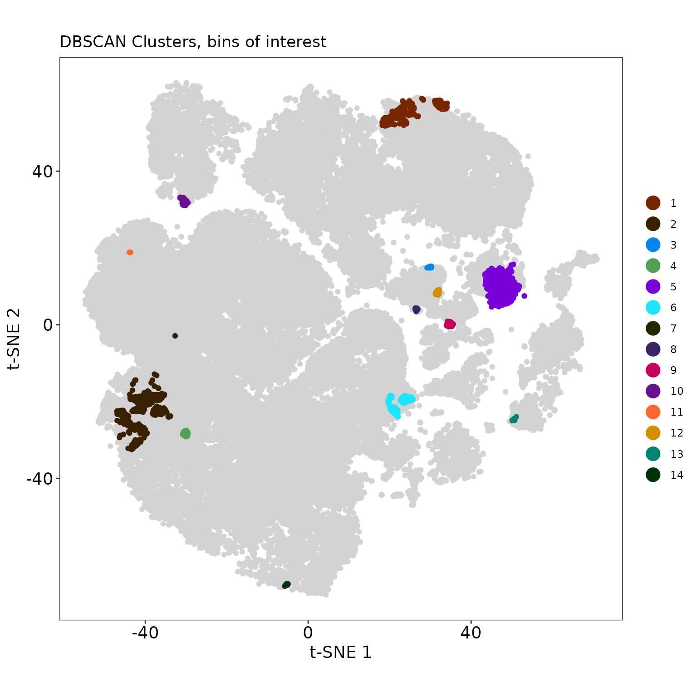
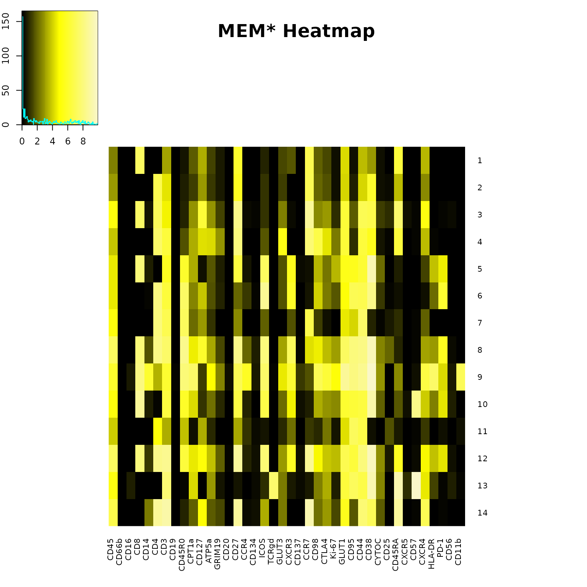
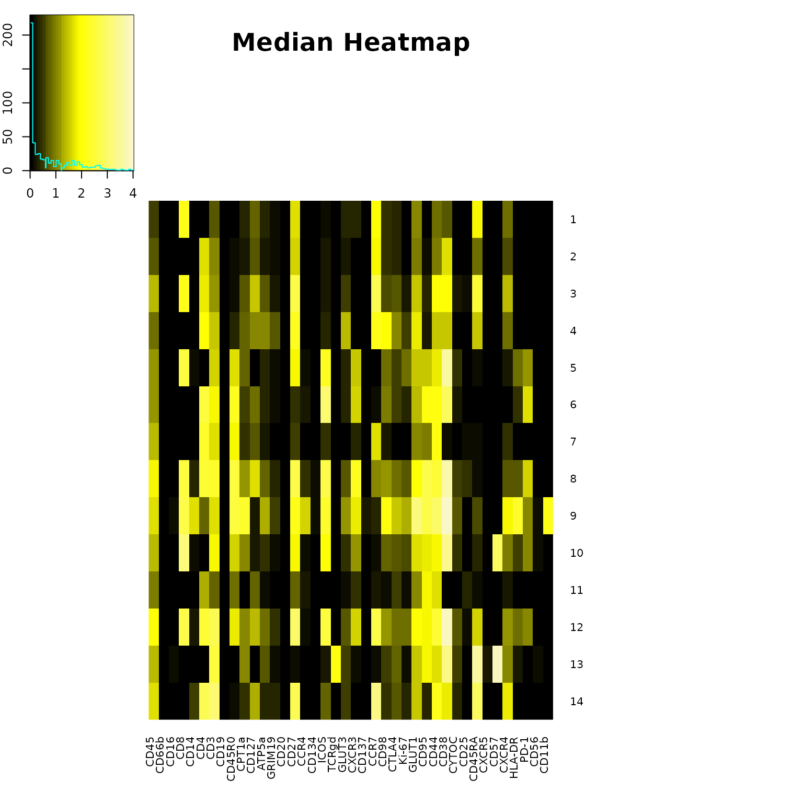
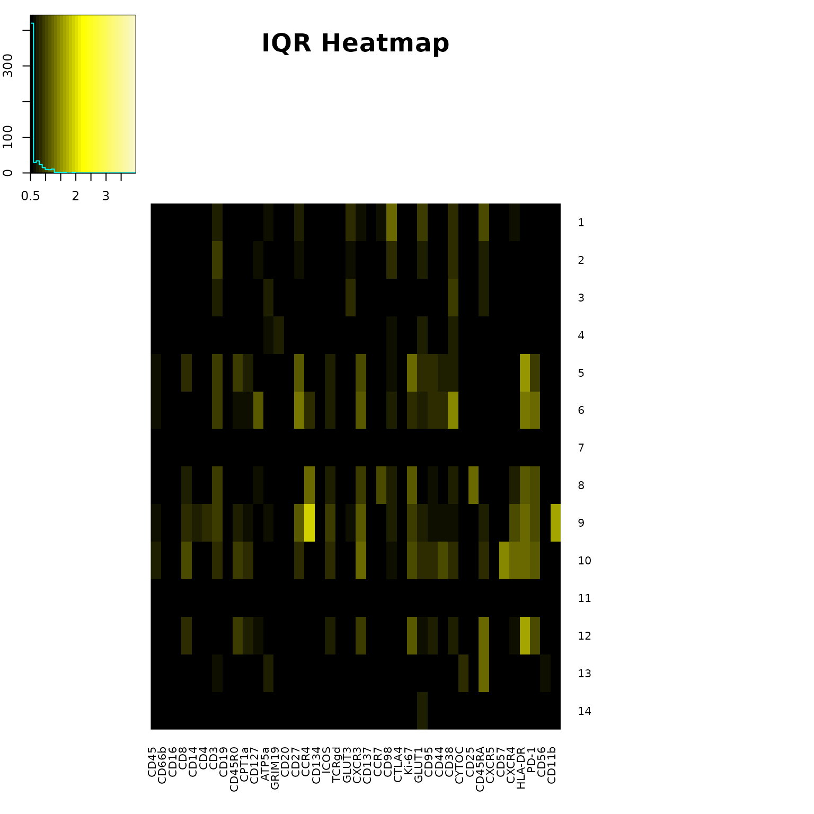

# T-REX Analysis on COVID Vaccine Data

## Tracking Responders Expanding

``` r

knitr::opts_chunk$set(
  fig.width = 8,
  fig.height = 8,
  dpi = 96
)
```

``` r

Folder <- system.file("extdata", package="TRexR")
StorageLocation <- file.path(Folder, "covid_vaccine")
fcs_files <- list.files(StorageLocation, pattern=".fcs", full.names=TRUE)

OutputLocation <- file.path(tempdir(), "TRexR-vignette")
dir.create(OutputLocation, showWarnings = FALSE, recursive = TRUE)
```

``` r

# read in files 
first.dataset <- as.data.frame(lapply(lapply(fcs_files[[1]], read.FCS, truncate_max_range=FALSE), exprs), check.names=FALSE)
second.dataset <- as.data.frame(lapply(lapply(fcs_files[[2]], read.FCS, truncate_max_range=FALSE), exprs), check.names=FALSE)

# save original column names for final export to FCS files 
orig.names <- colnames(first.dataset)

# rename columns with marker names 
colnames(first.dataset)[1:(length(first.dataset))] <- as.character(read.FCS(fcs_files[[1]], truncate_max_range=FALSE)@parameters@data[["desc"]])
#colnames(first.dataset)[1:2] <- c("Time", "Cell_length")
colnames(second.dataset)[1:(length(second.dataset))] <- as.character(read.FCS(fcs_files[[2]], truncate_max_range=FALSE)@parameters@data[["desc"]])

# create meaningful names for data sets to be analyzed 
first.dataset$file_ID = "Pre vaccine"
second.dataset$file_ID = "Post vaccine"
```

``` r

# find number of data points in smaller sample 
smaller_sample = nrow(first.dataset) 
if (nrow(second.dataset) < smaller_sample) { 
  smaller_sample <- nrow(second.dataset) 
}

# set a seed to get a reproducible sample 
set.seed(1)

# get an equal number of data points from both data sets
sampled.data = as.data.frame(rbind(
  first.dataset[sample(nrow(first.dataset), smaller_sample), ], 
  second.dataset[sample(nrow(second.dataset), smaller_sample), ]
))
```

``` r

# choose markers to make low dimensional embedding
chosen.data = sampled.data[ ,c(3,8,10:14,16,27,29,33:38,42,44:46,50,52:53,55:60,62,70)]

# scale data 
cofactor = c(45,15,10,10,10,15,5,15,25,15,15,15,15,15,25,25,15,15,25,15,15,45,15,15,45,25,25,15,25,15,25)
transformed.data = as.data.frame(t(apply(chosen.data, 1, function(x) asinh(x/cofactor))))

# if running a t-SNE, use transformed.data as the input 
```

``` r

# select data from a previously created t-SNE 
tsne.data = as.data.frame(cbind(sampled.data$tSNE1, sampled.data$tSNE2))
colnames(tsne.data) <- c("tSNE1", "tSNE2")
```

``` r

dataset.names = unique(sampled.data$file_ID)
output.folder = paste0(getwd(),"/data_files/covid vaccine/T-REX output, ", dataset.names[1], " vs ", dataset.names[2])
dir.create(output.folder)
```

    ## Warning in dir.create(output.folder): cannot create dir
    ## '/home/runner/work/TRexR/TRexR/vignettes/data_files/covid vaccine/T-REX output,
    ## Pre vaccine vs Post vaccine', reason 'No such file or directory'

``` r

my.binned = TREX(cbind(tsne.data, file_ID = sampled.data$file_ID))

TREX_plot(
  my.binned, 
  embed.type = "t-SNE", 
  caption = "Data from Kramer et al., bioRxiv. 2021",
  export = TRUE,
  outpath = OutputLocation
)
```


``` r

# The plot title will be incorrectly placed on the image below, but correctly placed on the exported png. The location is based on aspect ratio of the image, and can be adjusted with a title.height parameter if needed. 
```

``` r

TREX_results(my.binned, export = TRUE, outpath = OutputLocation)
```

    ##   total_cells [0,5] (5,15] (15,85) [85,95) [95,100] degree_of_change
    ## 1       90576  1577   4645   78396    1845     4113         6.282017
    ##   direction_of_change
    ## 1           0.4456942

``` r

my.clusters = TREX_cluster(
  binned.data = my.binned, 
  db.eps = 4, 
  marker.data = sampled.data
)

TREX_cluster_plot(
  cluster.data = my.clusters, 
  binned.data = my.binned, 
  embed.type = "t-SNE", 
  export = TRUE,
  outpath = OutputLocation
)
```



``` r

TREX_cluster_results(my.clusters, export = TRUE, outpath = OutputLocation)
```

    ##    cluster median.change mean.change
    ## 1        1      3.333333    3.046772
    ## 2        2      3.333333    3.336697
    ## 3        3      5.000000    5.000000
    ## 4        4      0.000000    1.111111
    ## 5        5     98.333333   98.611939
    ## 6        6     96.666667   96.810585
    ## 7        7      5.000000    5.000000
    ## 8        8     95.833333   95.833333
    ## 9        9    100.000000   99.559925
    ## 10      10     98.333333   97.555556
    ## 11      11      5.000000    5.000000
    ## 12      12     98.333333   98.264605
    ## 13      13     95.000000   95.666667
    ## 14      14     95.000000   95.555556

``` r

# select markers
MEM.input = my.clusters[, c(8,13,15:19,21,32:36,38:43,45,47,49:55,57:67,75,84)]

# scale marker data 
cofactor = c(45,15,10,10,10,15,5,15,25,25,15,15,15,15,15,15,15,25,25,15,15,15,25,15,25,25,15,15,45,15,15,15,45,25,25,15,25,25,15,25,1)
MEM.input <- as.data.frame(t(apply(MEM.input, 1, function(x) asinh(x/cofactor))))
MEM.input[, 41] <- my.clusters[, 84]

# run MEM on DBSCAN clusters from 5th and 95th percentiles 
# rename markers 
MEM.output = MEM(
  MEM.input, 
  zero.ref = TRUE,
  new.marker.names = "CD45,CD66b,CD16,CD8,CD14,CD4,CD3,CD19,CD45R0,CPT1a,CD127,ATP5a,GRIM19,CD20,CD27,CCR4,CD134,ICOS,TCRgd,GLUT3,CXCR3,CD137,CCR7,CD98,CTLA4,Ki-67,GLUT1,CD95,CD44,CD38,CYTOC,CD25,CD45RA,CXCR5,CD57,CXCR4,HLA-DR,PD-1,CD56,CD11b",
  scale.matrix = "arcsinh",
  scale.factor = 1
)

build_heatmaps(
  MEM.output, 
  cluster.MEM = "none", 
  output.files = TRUE
)
```



    ##  [1] "MEM label for cluster 1 : ▲ CD8+7 CCR7+7 CD27+6 CD45RA+6 GLUT1+4 CD44+4 CD3+3 CD127+3 CD38+3 CXCR4+3 CD45+2 CPT1a+2 CXCR3+2 CD98+2 ATP5a+1 GRIM19+1 ICOS+1 GLUT3+1 CTLA4+1 ▼ None"                                                                                                           
    ##  [2] "MEM label for cluster 2 : ▲ CD4+7 CCR7+7 CD27+6 CD38+6 CD3+4 GLUT1+4 CD44+4 CD45RA+4 CD45+3 CD127+3 CXCR4+3 CD98+2 CTLA4+2 CD45R0+1 CPT1a+1 ATP5a+1 GRIM19+1 ICOS+1 GLUT3+1 CD95+1 ▼ None"                                                                                                   
    ##  [3] "MEM label for cluster 3 : ▲ CCR7+9 CD27+8 CD45RA+8 CD8+7 CD4+7 CD44+7 CD38+7 CD127+6 GLUT1+6 CD45+5 CD3+5 CXCR4+5 CPT1a+3 ATP5a+3 CD98+3 CTLA4+3 GLUT3+2 CD95+2 CD45R0+1 GRIM19+1 ICOS+1 Ki-67+1 CYTOC+1 CD25+1 ▼ None"                                                                      
    ##  [4] "MEM label for cluster 4 : ▲ CD27+8 CCR7+8 CD4+7 CD98+7 CD3+6 GLUT1+6 CD44+6 CD38+6 CD45RA+6 GLUT3+5 CD45+4 CD127+4 ATP5a+4 CTLA4+4 CXCR4+4 CPT1a+3 GRIM19+3 CD45R0+2 ICOS+2 Ki-67+2 CD95+1 ▼ None"                                                                                           
    ##  [5] "MEM label for cluster 5 : ▲ CD38+9 CD8+8 ICOS+7 CD3+6 CD45R0+6 CD27+6 CXCR3+6 CD95+6 CD44+6 CD45+5 GLUT1+5 PD-1+5 HLA-DR+4 CPT1a+3 CD98+3 Ki-67+3 ATP5a+2 GLUT3+2 CTLA4+2 CYTOC+2 CD14+1 GRIM19+1 CD45RA+1 CXCR4+1 ▼ None"                                                                   
    ##  [6] "MEM label for cluster 6 : ▲ ICOS+9 CD4+8 CD38+8 CD45R0+7 CD95+7 CD44+7 CD3+6 CXCR3+6 PD-1+6 CD45+5 GLUT1+5 CD127+4 CD98+4 CPT1a+3 ATP5a+2 CD27+2 GLUT3+2 CTLA4+2 Ki-67+2 HLA-DR+2 GRIM19+1 CCR4+1 CYTOC+1 ▼ None"                                                                            
    ##  [7] "MEM label for cluster 7 : ▲ CD4+8 CD3+7 CD45R0+7 CCR7+7 CD44+7 CD45+5 GLUT1+4 CD95+4 CD127+3 CD27+3 CPT1a+2 ICOS+2 CXCR3+2 CXCR4+2 ATP5a+1 CD98+1 CD38+1 CD25+1 CD45RA+1 ▼ None"                                                                                                             
    ##  [8] "MEM label for cluster 8 : ▲ CD38+9 CD8+8 CD4+8 CD45R0+8 CD27+8 ICOS+8 CD95+8 CD44+8 CD45+7 CD3+7 CXCR3+7 GLUT1+7 CD127+6 PD-1+6 CPT1a+5 CD98+5 CCR7+4 CTLA4+4 ATP5a+3 GLUT3+3 Ki-67+3 CYTOC+3 CXCR4+3 HLA-DR+3 CD14+2 CCR4+2 CD25+2 GRIM19+1 CD134+1 CD45RA+1 ▼ None"                        
    ##  [9] "MEM label for cluster 9 : ▲ CD38+10 GLUT1+9 CD8+8 CD45R0+8 CPT1a+8 CD95+8 CD44+8 HLA-DR+8 CD27+7 ICOS+7 CD98+7 CXCR4+7 CD11b+7 CD45+6 CD14+6 CD3+6 CCR4+6 CXCR3+6 CTLA4+6 ATP5a+5 GLUT3+5 Ki-67+5 PD-1+4 CD4+3 GRIM19+3 CYTOC+3 CD45RA+3 CCR7+2 CD16+1 CD127+1 CD134+1 CD137+1 CD56+1 ▼ None"
    ## [10] "MEM label for cluster 10 : ▲ CD8+9 CD38+9 CD57+8 CD27+7 ICOS+7 CD44+7 CD3+6 CD45R0+6 GLUT1+6 CD95+6 CD45+5 CXCR3+5 CPT1a+4 CXCR4+4 PD-1+4 CD98+3 CTLA4+3 Ki-67+3 ATP5a+2 GLUT3+2 CYTOC+2 CD45RA+2 HLA-DR+2 CD14+1 CD127+1 GRIM19+1 CCR4+1 CCR7+1 CD56+1 ▼ None"                              
    ## [11] "MEM label for cluster 11 : ▲ CD95+7 CD44+7 CD4+5 CD45+4 CD45R0+4 GLUT1+4 CD3+3 CD127+3 CD27+3 CXCR3+2 CTLA4+2 CD25+2 ATP5a+1 CCR4+1 GLUT3+1 CCR7+1 CD98+1 CD45RA+1 CXCR4+1 ▼ None"                                                                                                           
    ## [12] "MEM label for cluster 12 : ▲ CD38+10 CD27+9 CCR7+9 CD8+8 CD4+8 CD3+8 ICOS+8 CD44+8 CD45+7 GLUT1+7 CD45R0+6 CXCR3+6 CD95+6 CD45RA+6 CD127+5 CD98+5 CXCR4+5 CPT1a+4 ATP5a+4 CTLA4+4 Ki-67+4 HLA-DR+4 PD-1+4 GLUT3+3 CYTOC+3 GRIM19+2 CD14+1 CCR4+1 CD25+1 ▼ None"                              
    ## [13] "MEM label for cluster 13 : ▲ CD57+10 CD38+9 CD45RA+9 CD3+8 TCRgd+8 CD95+7 CD44+7 GLUT1+6 CD45+5 CPT1a+4 CXCR4+4 ATP5a+3 CTLA4+3 CYTOC+3 GLUT3+2 CD98+2 CD16+1 ICOS+1 CXCR3+1 CCR7+1 Ki-67+1 CXCR5+1 HLA-DR+1 CD56+1 ▼ None"                                                                  
    ## [14] "MEM label for cluster 14 : ▲ CD4+9 CD3+9 CD27+9 CCR7+9 CD45RA+9 CD44+8 CD45+7 CD38+7 CXCR4+7 GLUT1+6 CD127+5 ICOS+3 CTLA4+3 CD14+2 CPT1a+2 ATP5a+2 GLUT3+2 CD98+2 CD95+2 CYTOC+2 CD45R0+1 GRIM19+1 Ki-67+1 ▼ None"

``` r

TREX_counts(my.clusters, export = TRUE, outpath = OutputLocation)
```

    ##    cluster total_cells [0,5] [95,100]
    ## 1        1         506   506        0
    ## 2        2         991   991        0
    ## 3        3          10    10        0
    ## 4        4          66    66        0
    ## 5        5        3356     0     3356
    ## 6        6         359     0      359
    ## 7        7           1     1        0
    ## 8        8          42     0       42
    ## 9        9         178     0      178
    ## 10      10          60     0       60
    ## 11      11           3     3        0
    ## 12      12          97     0       97
    ## 13      13          15     0       15
    ## 14      14           6     0        6

``` r

tsne.bychannel <- as_tibble(tsne.data) %>%
  bind_cols(transformed.data)  %>%
  gather(channel, intensity, -tSNE1, -tSNE2) %>%
  mutate(across(channel,factor))%>%
  group_split(channel) %>%
  map(
    ~ggplot(.,aes(x = tSNE1, y = tSNE2, col = intensity)) +
      geom_point(shape = ".", size = 8) +
      scale_color_gradientn(
        colours = colorRampPalette(rev(brewer.pal(n = 11, name = "Spectral")))(5)) +
      facet_grid(~ channel, labeller = function(x) label_value(x, multi_line = FALSE)) +
      coord_fixed() +
      theme_bw() +
      theme(
        strip.text.x = element_text(size = 20),
        legend.title = element_blank(),
        panel.grid = element_blank(),
        axis.title = element_blank(),
        axis.text = element_blank(),
        axis.ticks = element_blank()
      )
    ) %>%
  plot_grid(plotlist = ., align = 'hv', ncol = 8)

theFileName <- paste(strftime(Sys.time(),"%Y-%m-%d_%H-%M"),"_marker_heat.png")
StashHere <- file.path(OutputLocation, theFileName)

png(
  StashHere,
  height = 2000,
  width = 4000
)
print(tsne.bychannel)
dev.off()
```

    ## agg_png 
    ##       2

``` r

# export new FCS files with sampled data, percent change, and tsne axes
to.export = cbind(sampled.data, tsne.data, percent.change = my.binned$percent.change)

# add column for cluster number 
to.export$cluster <- c(0)
bins.of.interest = unique(my.clusters$cuts)
temp.cuts = wafflecut(to.export$percent.change, levels(my.binned$cuts))
to.export[temp.cuts %in% bins.of.interest, ]$cluster <- my.clusters$cluster

desc = colnames(to.export)
desc <- desc[! desc %in% c("file_ID")]
colnames(to.export)[1:ncol(sampled.data) - 1] <- orig.names
sep.files = split(to.export, to.export$`file_ID`)
for (i in 1:length(sep.files)){
  reduce.data = subset(sep.files[[i]], select = -c(`file_ID`))
  mat.input<- as.matrix(reduce.data)
  metadata <- data.frame(name = dimnames(mat.input)[[2]], desc = desc)
  metadata$range <- apply(apply(mat.input, 2, range), 2, diff)
  metadata$minRange <- apply(mat.input, 2, min)
  metadata$maxRange <- apply(mat.input, 2, max)
  input.flowframe <- new("flowFrame", exprs = mat.input, parameters = AnnotatedDataFrame(metadata))  
  newname  = str_remove(basename(fcs_files[i]), ".fcs")
  new.filename = file.path(OutputLocation, paste0(strftime(Sys.time(),"%Y-%m-%d_%H-%M"), "_", newname,"_T-REX.fcs"))
  write.FCS(input.flowframe, filename = new.filename)
  print(paste("FCS file ",i," done", sep = ""))
}
```

    ## [1] "FCS file 1 done"
    ## [1] "FCS file 2 done"

``` r

# MEM Clean Up, still making an output files folder, remove it. 
if (dir.exists("output files")){unlink("output files", recursive=TRUE)}
```

``` r

sessionInfo()
```

    ## R version 4.6.2 (2026-10-29)
    ## Platform: x86_64-pc-linux-gnu
    ## Running under: Ubuntu 24.04.5 LTS
    ## 
    ## Matrix products: default
    ## BLAS:   /usr/lib/x86_64-linux-gnu/openblas-pthread/libblas.so.3 
    ## LAPACK: /usr/lib/x86_64-linux-gnu/openblas-pthread/libopenblasp-r0.3.26.so;  LAPACK version 3.12.0
    ## 
    ## locale:
    ##  [1] LC_CTYPE=C.UTF-8       LC_NUMERIC=C           LC_TIME=C.UTF-8       
    ##  [4] LC_COLLATE=C.UTF-8     LC_MONETARY=C.UTF-8    LC_MESSAGES=C.UTF-8   
    ##  [7] LC_PAPER=C.UTF-8       LC_NAME=C              LC_ADDRESS=C          
    ## [10] LC_TELEPHONE=C         LC_MEASUREMENT=C.UTF-8 LC_IDENTIFICATION=C   
    ## 
    ## time zone: UTC
    ## tzcode source: system (glibc)
    ## 
    ## attached base packages:
    ## [1] stats     graphics  grDevices utils     datasets  methods   base     
    ## 
    ## other attached packages:
    ##  [1] TRexR_0.99.1        fancycut_0.1.4      cowplot_1.2.0      
    ##  [4] purrr_1.2.2         stringr_1.6.0       dplyr_1.2.1        
    ##  [7] RColorBrewer_1.1-3  Biobase_2.72.0      BiocGenerics_0.58.1
    ## [10] generics_0.1.4      tidyr_1.3.2         cytoMEM_1.16.0     
    ## [13] ggplot2_4.0.3       uwot_0.2.5          Matrix_1.7-6       
    ## [16] flowCore_2.24.0    
    ## 
    ## loaded via a namespace (and not attached):
    ##  [1] sass_0.4.10         gplots_3.3.0        bitops_1.1-0       
    ##  [4] KernSmooth_2.23-27  gtools_3.9.5        stringi_1.8.9      
    ##  [7] lattice_0.23-1      caTools_1.18.4      digest_0.6.39      
    ## [10] magrittr_2.0.5      evaluate_1.0.5      grid_4.6.2         
    ## [13] fastmap_1.2.0       jsonlite_2.0.0      gridExtra_2.3.1    
    ## [16] scales_1.4.0        textshaping_1.0.5   jquerylib_0.1.4    
    ## [19] cli_3.6.6           rlang_1.3.0         RProtoBufLib_2.24.0
    ## [22] withr_3.0.3         cachem_1.1.0        yaml_2.3.12        
    ## [25] FNN_1.1.4.1         otel_0.3.0          cytolib_2.24.0     
    ## [28] tools_4.6.2         vctrs_0.7.3         R6_2.6.1           
    ## [31] matrixStats_1.5.0   stats4_4.6.2        lifecycle_1.0.5    
    ## [34] dbscan_1.2.7        S4Vectors_0.50.3    fs_2.1.0           
    ## [37] ragg_1.5.2          pkgconfig_2.0.3     desc_1.4.3         
    ## [40] pkgdown_2.2.1       bslib_0.12.0        pillar_1.11.1      
    ## [43] gtable_0.3.6        glue_1.8.1          Rcpp_1.1.2         
    ## [46] systemfonts_1.3.2   xfun_0.62           tibble_3.3.1       
    ## [49] tidyselect_1.2.1    knitr_1.52          farver_2.1.2       
    ## [52] htmltools_0.5.9     labeling_0.4.3      rmarkdown_2.32     
    ## [55] compiler_4.6.2      S7_0.2.2
