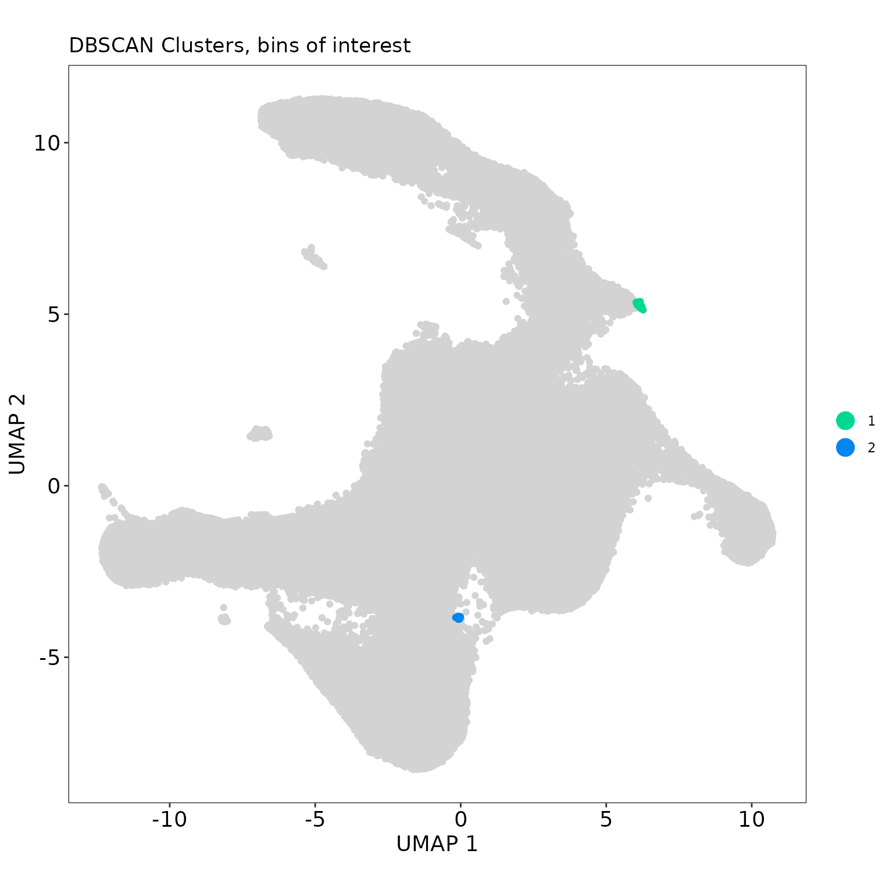
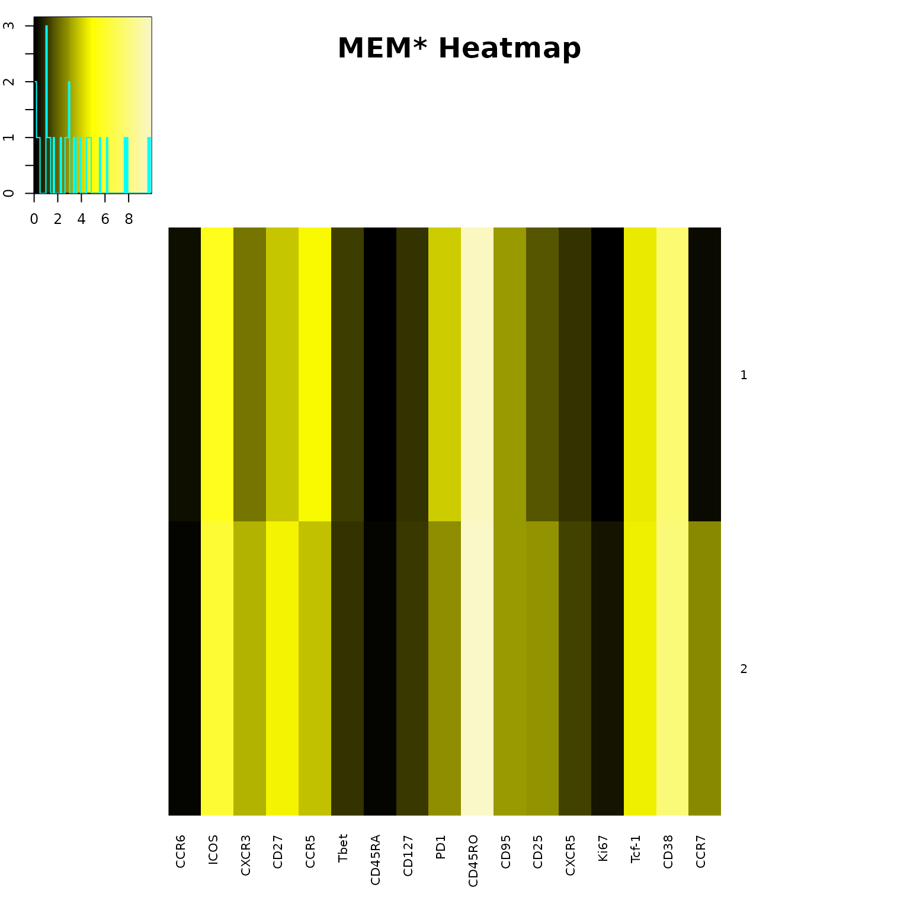
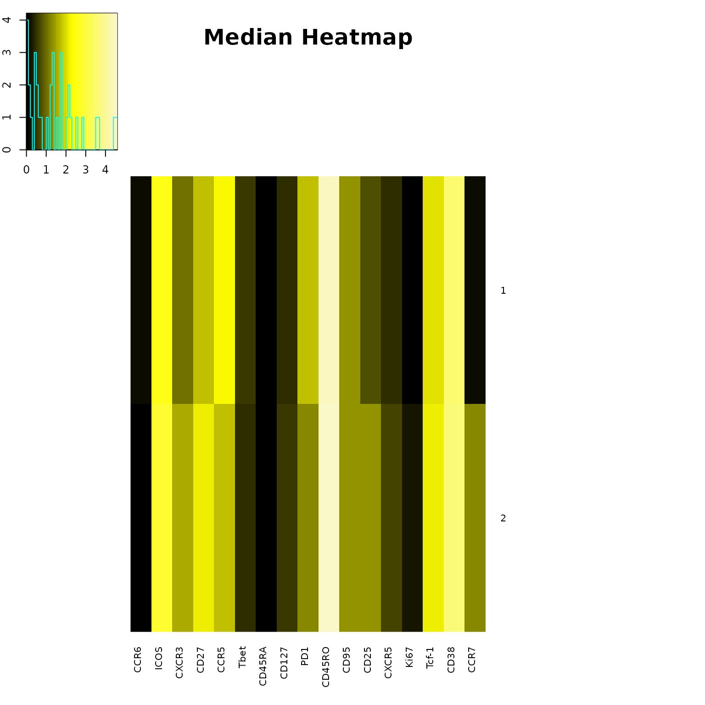
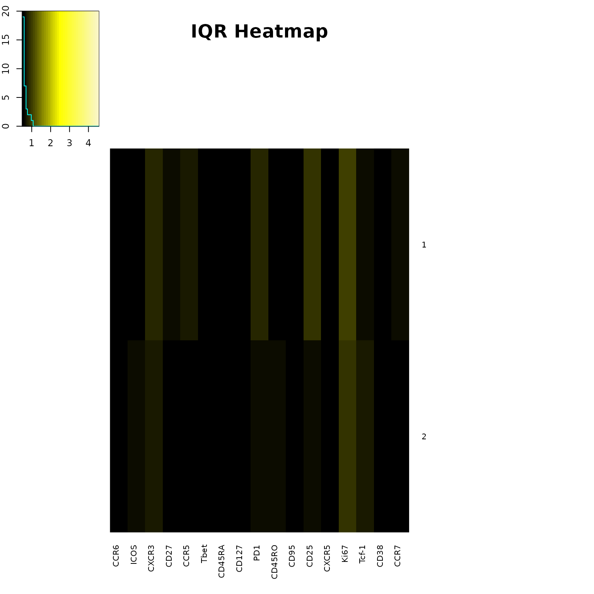

# T-REX Analysis on RV 001

## Tracking Responders Expanding

``` r

knitr::opts_chunk$set(
  fig.width = 8,
  fig.height = 8,
  dpi = 96
)
```

``` r

Folder <- system.file("extdata", package="TRexR")
StorageLocation <- file.path(Folder, "rhinovirus")
fcs_files <- list.files(StorageLocation, pattern=".fcs", full.names=TRUE)

OutputLocation <- file.path(tempdir(), "TRexR-vignette")
dir.create(OutputLocation, showWarnings = FALSE, recursive = TRUE)
```

``` r

# read in files 
first.dataset <- as.data.frame(lapply(lapply(
  fcs_files[[1]], read.FCS, truncate_max_range=FALSE), exprs), check.names=FALSE)
second.dataset <- as.data.frame(lapply(lapply(
  fcs_files[[2]], read.FCS, truncate_max_range=FALSE), exprs), check.names=FALSE)

# save original column names for final export to FCS files 
orig.names <- colnames(first.dataset)

# rename columns with marker names 
colnames(first.dataset)[1:(length(first.dataset))] <- as.character(
  read.FCS(fcs_files[[1]], truncate_max_range=FALSE)@parameters@data[["desc"]])

#colnames(first.dataset)[1:2] <- c("Time", "Cell_length")

colnames(second.dataset)[1:(length(second.dataset))] <- as.character(
  read.FCS(fcs_files[[2]], truncate_max_range=FALSE)@parameters@data[["desc"]])

# create meaningful names for data sets to be analyzed
first.dataset$file_ID = "day 0"
second.dataset$file_ID = "day 28"
```

``` r

# find number of data points in smaller sample 
smaller_sample = nrow(first.dataset) 
if (nrow(second.dataset) < smaller_sample) { 
  smaller_sample <- nrow(second.dataset) 
}

# set a seed to get a reproducible sample 
set.seed(1)

# get an equal number of data points from both data sets
sampled.data = as.data.frame(rbind(
  first.dataset[sample(nrow(first.dataset), smaller_sample), ], 
  second.dataset[sample(nrow(second.dataset), smaller_sample), ]
))
```

``` r

# choose markers to use in later analysis 
chosen.data = sampled.data[, c(8:12,14:18,21,25:29,31)]

# scale data with a cofactor of 6000 
transformed.data = as.data.frame(t(apply(chosen.data, 1, function(x) asinh(x/6000))))
```

``` r

dataset.names = unique(sampled.data$file_ID)
output.folder = paste0(getwd(), "/data_files/rhinovirus/T-REX output, ", dataset.names[1], " vs ", dataset.names[2])
dir.create(output.folder)
```

    ## Warning in dir.create(output.folder): cannot create dir
    ## '/home/runner/work/TRexR/TRexR/vignettes/data_files/rhinovirus/T-REX output,
    ## day 0 vs day 28', reason 'No such file or directory'

``` r

# select markers to make low dimensional embedding
# umap.input = transformed.data[, c(1:5,7:13,16:17)]

# uncomment lines below to run UMAP amd save model
# myumap <- umap(umap.input, ret_model = TRUE, verbose = TRUE)
# save_uwot(myumap, paste0(strftime(Sys.time(),"%Y-%m-%d_%H%M%S"),"_umap_model_results"))

# select data from a previously created UMAP   
umap.data <- as.data.frame(cbind(sampled.data$UMAP1, sampled.data$UMAP2))
colnames(umap.data) <- c("UMAP1", "UMAP2")
```

``` r

my.binned = TREX(cbind(umap.data, file_ID = sampled.data$file_ID))

TREX_plot(
  binned.data = my.binned, 
  embed.type = "UMAP",
  caption = "Data from Barone et al., eLife. 2021",
  export = TRUE,
  outpath = OutputLocation
)
```


``` r

# The plot title will be incorrectly placed on the image below, but correctly placed on the exported png. The location is based on aspect ratio of the image, and can be adjusted with a title.height parameter if needed. 
```

``` r

TREX_results(my.binned, export = TRUE, outpath = OutputLocation)
```

    ##   total_cells [0,5] (5,15] (15,85) [85,95) [95,100] degree_of_change
    ## 1      200000     0    128  199359     226      287           0.1435
    ##   direction_of_change
    ## 1                   1

``` r

my.clusters = TREX_cluster(
  binned.data = my.binned, 
  db.eps = 0.4,
  marker.data = sampled.data[, c(8:12,14:18,21,25:29,31)]
)

TREX_cluster_plot(
  cluster.data = my.clusters, 
  binned.data = my.binned, 
  embed.type = "UMAP",
  export = TRUE,
  outpath = OutputLocation
)
```



``` r

TREX_cluster_results(my.clusters, export = TRUE, outpath = OutputLocation)
```

    ##   cluster median.change mean.change
    ## 1       1      98.33333    97.76680
    ## 2       2      95.00000    95.19608

``` r

# run MEM on DBSCAN clusters from 5th and 95th percentiles 
MEM.input = my.clusters[, c(6:ncol(my.clusters))]
MEM.input <- MEM.input[order(MEM.input$cluster), ]
MEM.output = MEM(
  MEM.input, 
  transform = TRUE, 
  cofactor = 6000,
  choose.markers = FALSE,
  markers = "all",
  choose.ref = FALSE,
  zero.ref = TRUE, 
  rename.markers = FALSE,
  new.marker.names = "none",
  file.is.clust = FALSE,
  add.fileID = FALSE,
  IQR.thresh = NULL
)

build_heatmaps(
  MEM.output, 
  cluster.MEM = "none", 
  cluster.medians = "none",
  display.thresh = 1,
  output.files = TRUE, 
  labels = FALSE
)
```



    ## [1] "MEM label for cluster 1 : ▲ CD45RO+10 CD38+8 ICOS+6 CCR5+5 CD27+4 PD1+4 Tcf-1+4 CD95+3 CXCR3+2 CD25+2 Tbet+1 CD127+1 CXCR5+1 ▼ None"       
    ## [2] "MEM label for cluster 2 : ▲ CD45RO+10 CD38+8 ICOS+6 CD27+5 Tcf-1+5 CCR5+4 CXCR3+3 PD1+3 CD95+3 CD25+3 CCR7+3 Tbet+1 CD127+1 CXCR5+1 ▼ None"

``` r

TREX_counts(my.clusters, export = TRUE, outpath = OutputLocation)
```

    ##   cluster total_cells [95,100]
    ## 1       1         253      253
    ## 2       2          34       34

``` r

# create heatmaps of every marker across UMAP axes 
umap.bychannel <- as_tibble(umap.data) %>%
  bind_cols(transformed.data)  %>%
  gather(channel, intensity, -UMAP1, -UMAP2) %>%
  mutate(across(channel,factor)) %>%
  group_split(channel) %>%
  map(
    ~ggplot(., aes(x = UMAP1, y = UMAP2, col = intensity)) +
      geom_point(shape = ".", size = 8) +
      scale_color_gradientn(
        colours = colorRampPalette(rev(brewer.pal(n = 11, name = "Spectral")))(5)) +
      facet_grid(~ channel, labeller = function(x) label_value(x, multi_line = FALSE)) +
      coord_fixed() +
      theme_bw() +
      theme(
        strip.text.x = element_text(size = 20),
        legend.title = element_blank(),
        panel.grid = element_blank(),
        axis.title = element_blank(),
        axis.text = element_blank(),
        axis.ticks = element_blank()
      )
    ) %>%
  plot_grid(plotlist = ., align = 'hv', ncol = 6)

theFileName <- paste0(strftime(Sys.time(),"%Y-%m-%d_%H-%M"),"_marker_heat.png")
StashHere <- file.path(OutputLocation, theFileName)

png(
  StashHere,
  height = 2000,
  width = 4000
)
print(umap.bychannel)
dev.off()
```

    ## agg_png 
    ##       2

``` r

# export new FCS files with sampled data, percent change, and umap axes
to.export = cbind(sampled.data, umap.data, percent.change = my.binned$percent.change)

# add column for cluster number 
to.export$cluster <- c(0)
bins.of.interest = unique(my.clusters$cuts)
temp.cuts = wafflecut(to.export$percent.change, levels(my.binned$cuts))
to.export[temp.cuts %in% bins.of.interest, ]$cluster <- my.clusters$cluster

desc = colnames(to.export)
desc <- desc[! desc %in% c("file_ID")]
colnames(to.export)[1:ncol(sampled.data) - 1] <- orig.names
sep.files = split(to.export, to.export$`file_ID`)
for (i in 1:length(sep.files)) {
  reduce.data = subset(sep.files[[i]], select = -c(`file_ID`))
  mat.input<- as.matrix(reduce.data)
  metadata <- data.frame(name = dimnames(mat.input)[[2]], desc = desc)
  metadata$range <- apply(apply(mat.input, 2, range), 2, diff)
  metadata$minRange <- apply(mat.input, 2, min)
  metadata$maxRange <- apply(mat.input, 2, max)
  input.flowframe <- new("flowFrame", exprs= mat.input, parameters = AnnotatedDataFrame(metadata))  
  newname  = str_remove(basename(fcs_files[i]), ".fcs")
  new.filename = file.path(OutputLocation, paste0(strftime(Sys.time(), "%Y-%m-%d_%H-%M"), "_", newname,"_T-REX.fcs"))
  write.FCS(input.flowframe, filename = new.filename)
  print(paste("FCS file ",i," done", sep = ""))
}
```

    ## [1] "FCS file 1 done"
    ## [1] "FCS file 2 done"

``` r

# MEM Clean Up, still making an output files folder, remove it. 
if (dir.exists("output files")){unlink("output files", recursive=TRUE)}
```

``` r

pos.1 <- which(sampled.data$`Tetra1`>18000 & sampled.data$`Tetra2`<18000 & sampled.data$`Tetra3`<18000)
pos.3 <- which(sampled.data$`Tetra1`<18000 & sampled.data$`Tetra2`<18000 & sampled.data$`Tetra3`>18000)
pos.2 <- which(sampled.data$`Tetra1`<18000 & sampled.data$`Tetra2`>18000 & sampled.data$`Tetra3`<18000)
tetrapos.cells = c(pos.1,pos.2,pos.3)

kvalue = 60
neighbor_index = knnx.index(umap.data, umap.data, k = kvalue)
tetra.pos.knn = which(matrix(neighbor_index %in% tetrapos.cells, dim(neighbor_index)), arr.ind = TRUE) 
neighbor_index[tetra.pos.knn] <- 1
neighbor_index[neighbor_index != 1] <- 0
total.tetra.count = (rowSums(neighbor_index)/kvalue*100)

theFileName <- paste(strftime(Sys.time(),"%Y-%m-%d_%H-%M")," box and whisker 1 percent.pdf")
StashHere <- file.path(OutputLocation, theFileName)
pdf(StashHere, width = 5)

percent_change = round(my.binned$percent.change)
data.to.plot = as.data.frame(cbind(percent_change, total.tetra.count))
data.to.plot$percent_change <- as.factor(data.to.plot$percent_change)
print(
  ggplot(data.to.plot, aes(x = percent_change, y = total.tetra.count)) + 
  geom_boxplot(outlier.shape = NA, fill = "gray") + 
  labs(
    x = paste("% change in KNN region k=", kvalue), 
    y = "% Tetramer+ in KNN region") +
  theme_classic()
)
dev.off()
```

    ## agg_png 
    ##       2

``` r

theFileName <- paste(strftime(Sys.time(),"%Y-%m-%d_%H-%M")," UMAP_plot_percent_change_95.png")
StashHere <- file.path(OutputLocation, theFileName)

png(
  StashHere,
  res = 200,
  width = 1500,
  height = 1500
)

i = 5
graphical.ratio = 1.178857

tetra.data = sampled.data
tetra.data$status <- 0
data.to.plot = as.data.frame(cbind(my.binned$percent.change, total.tetra.count))
colnames(data.to.plot) <- c("percent.change", "total.tetra.count")

indices.post.enriched = which(data.to.plot$percent.change >= 95)
tetra.data[indices.post.enriched, ]$status <- 1
indices.post.enriched.tetra = which(data.to.plot$percent.change >= 95 & data.to.plot$total.tetra.count >= i)
tetra.data[indices.post.enriched.tetra, ]$status <- 2
tetra.data.ordered <- tetra.data[order(tetra.data$status), ]

clinical_clusters <- ggplot(tetra.data.ordered, aes(x = UMAP1, y = UMAP2, col = as.factor(tetra.data.ordered$status))) +
  geom_point() +
  scale_color_manual(
    values = c("0" = "lightgray", "1" = "darkred", "2" = "deeppink"), 
    labels = c("does not pass % change cutoff",
               paste0("passes % change cutoff, tet- (",summary(as.factor(tetra.data.ordered$status))[2]," cells)"), 
               paste0("passes % change cutoff, tet+ (",summary(as.factor(tetra.data.ordered$status))[3]," cells)")), 
    name = NULL
  ) +
  guides(colour = guide_legend(override.aes = list(size = 5))) + 
  theme_bw() + 
  theme(
    panel.grid.major = element_blank(), 
    panel.grid.minor = element_blank()
  ) + 
  labs(
    x = "UMAP1", 
    y = "UMAP2", 
    title = paste0("% change above 95, % tetra+ at ",i)
  ) + 
  coord_fixed(ratio = graphical.ratio)

print(clinical_clusters)
dev.off()
```

    ## agg_png 
    ##       2

``` r

theFileName <- paste(strftime(Sys.time(),"%Y-%m-%d_%H-%M")," UMAP_plot_tet_change_95.png")
StashHere <- file.path(OutputLocation, theFileName)

png(
  StashHere,
  res = 200,
  width = 1500,
  height = 1500
)

tetra.data$status <- 0
indices.post.enriched.tetra = which(data.to.plot$percent.change >= 95 & data.to.plot$total.tetra.count >= i)
tetra.data[indices.post.enriched.tetra, ]$status <- 2
indices.tetra = which(data.to.plot$percent.change < 95 & data.to.plot$total.tetra.count >= i)
tetra.data[indices.tetra, ]$status <- 1
tetra.data.ordered <- tetra.data[order(tetra.data$status), ]

clinical_clusters <- ggplot(tetra.data.ordered, aes(x = UMAP1, y = UMAP2, col = as.factor(tetra.data.ordered$status))) + 
  geom_point() + 
  scale_color_manual(
    values = c("0" = "lightgray", "1" = "purple", "2" = "deeppink"),
    labels = c("tet-",
               paste0("does not pass % change cutoff, tet+ (",summary(as.factor(tetra.data.ordered$status))[2]," cells)"),
               paste0("passes % change cutoff, tet+ (",summary(as.factor(tetra.data.ordered$status))[3]," cells)")), 
    name = NULL
  ) + 
  theme_bw() +
  guides(colour = guide_legend(override.aes = list(size=5))) + 
  theme_bw() + 
  theme(
    panel.grid.major = element_blank(), 
    panel.grid.minor = element_blank()
  ) + 
  labs (x = "UMAP1", y = "UMAP2", title = paste0("% change at 95, % tetra+ at ",i)) + 
  coord_fixed(ratio = graphical.ratio)

print(clinical_clusters)
dev.off()
```

    ## agg_png 
    ##       2

``` r

sessionInfo()
```

    ## R version 4.6.2 (2026-10-29)
    ## Platform: x86_64-pc-linux-gnu
    ## Running under: Ubuntu 24.04.5 LTS
    ## 
    ## Matrix products: default
    ## BLAS:   /usr/lib/x86_64-linux-gnu/openblas-pthread/libblas.so.3 
    ## LAPACK: /usr/lib/x86_64-linux-gnu/openblas-pthread/libopenblasp-r0.3.26.so;  LAPACK version 3.12.0
    ## 
    ## locale:
    ##  [1] LC_CTYPE=C.UTF-8       LC_NUMERIC=C           LC_TIME=C.UTF-8       
    ##  [4] LC_COLLATE=C.UTF-8     LC_MONETARY=C.UTF-8    LC_MESSAGES=C.UTF-8   
    ##  [7] LC_PAPER=C.UTF-8       LC_NAME=C              LC_ADDRESS=C          
    ## [10] LC_TELEPHONE=C         LC_MEASUREMENT=C.UTF-8 LC_IDENTIFICATION=C   
    ## 
    ## time zone: UTC
    ## tzcode source: system (glibc)
    ## 
    ## attached base packages:
    ## [1] stats     graphics  grDevices utils     datasets  methods   base     
    ## 
    ## other attached packages:
    ##  [1] FNN_1.1.4.1         TRexR_0.99.1        fancycut_0.1.4     
    ##  [4] cowplot_1.2.0       purrr_1.2.2         stringr_1.6.0      
    ##  [7] dplyr_1.2.1         RColorBrewer_1.1-3  Biobase_2.72.0     
    ## [10] BiocGenerics_0.58.1 generics_0.1.4      tidyr_1.3.2        
    ## [13] cytoMEM_1.16.0      ggplot2_4.0.3       uwot_0.2.5         
    ## [16] Matrix_1.7-6        flowCore_2.24.0    
    ## 
    ## loaded via a namespace (and not attached):
    ##  [1] sass_0.4.10         gplots_3.3.0        bitops_1.1-0       
    ##  [4] KernSmooth_2.23-27  gtools_3.9.5        stringi_1.8.9      
    ##  [7] lattice_0.23-1      caTools_1.18.4      digest_0.6.39      
    ## [10] magrittr_2.0.5      evaluate_1.0.5      grid_4.6.2         
    ## [13] fastmap_1.2.0       jsonlite_2.0.0      gridExtra_2.3.1    
    ## [16] scales_1.4.0        textshaping_1.0.5   jquerylib_0.1.4    
    ## [19] cli_3.6.6           rlang_1.3.0         RProtoBufLib_2.24.0
    ## [22] withr_3.0.3         cachem_1.1.0        yaml_2.3.12        
    ## [25] otel_0.3.0          cytolib_2.24.0      tools_4.6.2        
    ## [28] vctrs_0.7.3         R6_2.6.1            matrixStats_1.5.0  
    ## [31] stats4_4.6.2        lifecycle_1.0.5     dbscan_1.2.7       
    ## [34] S4Vectors_0.50.3    fs_2.1.0            ragg_1.5.2         
    ## [37] pkgconfig_2.0.3     desc_1.4.3          pkgdown_2.2.1      
    ## [40] bslib_0.12.0        pillar_1.11.1       gtable_0.3.6       
    ## [43] glue_1.8.1          Rcpp_1.1.2          systemfonts_1.3.2  
    ## [46] xfun_0.62           tibble_3.3.1        tidyselect_1.2.1   
    ## [49] knitr_1.52          farver_2.1.2        htmltools_0.5.9    
    ## [52] labeling_0.4.3      rmarkdown_2.32      compiler_4.6.2     
    ## [55] S7_0.2.2
